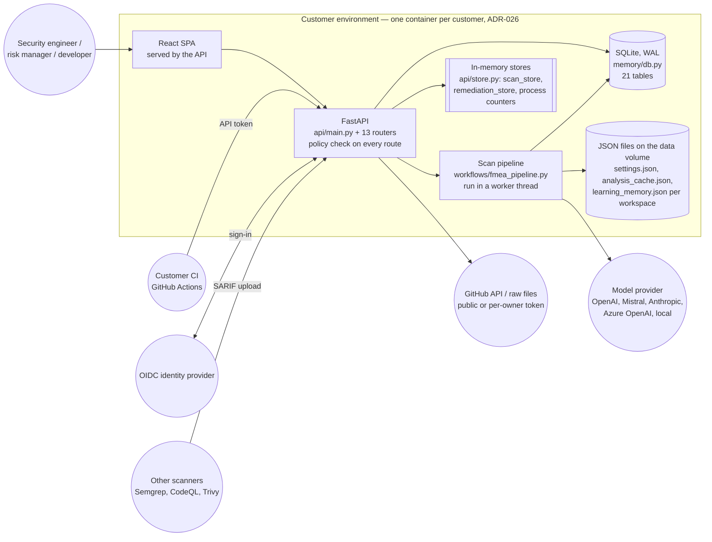
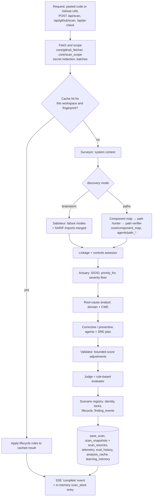

# System design review: architecture as built, strategy, gaps and recommendations

> Date: 2026-11-23 · Branch read: `feature/b056-fix-proposals` (with B-056 work uncommitted) · Inputs: the Python and React code, `docs/BACKLOG.md`, ADR-001..034, `docs/DISCOVERY-2026-11.md`, harness reports.
> Nothing here is implemented. The engineer accepted the suggested order and priorities of B-058..B-069 on 2026-11-23; items marked "ADR first" still need an accepted ADR before code (CLAUDE.md rules 5 and 6).
> Confidence: high on the gaps marked "read in code" (file and line evidence given); medium on scale limits (reasoned, not load-tested); low on market statements (carried from the discovery report, not re-checked).

---

## 1. Product vision and strategy (as the repository states it)

**Vision.** *The risk register that is written from your code.* An AI-native, continuous FMEA for software: every finding is evidenced from the code, scored in business terms (S/O/D, RPN, a severity floor so catastrophic items cannot be buried), locked and auditable with human override, with an honest statement of what was *not* examined, and with corrective and preventive action.

**Company goal, three parts.** (1) Understand risk, (2) remediate it, (3) prevent it long term.

**Positioning.** Not "AI SAST". The risk layer above the customer's existing scanners (SARIF in, SARIF out), sold to the risk owner and the head of security together.

**Beachhead.** Regulated software teams of 50-500 engineers (fintech, health, B2B SaaS selling to enterprises) under DORA / NIS2 and customer-audit pressure. Second act: safety-critical teams (ISO 14971, ISO 26262), which needs C and C++.

**Offer ladder.** Paid risk assessment (report + walkthrough) → 8-12 week self-hosted pilot → per-contributor or per-repository subscription.

**Deployment model.** Single-tenant, self-hosted container with the customer's own model key (ADR-026).

**What each pillar has today.**

| Pillar | Built | Missing |
|---|---|---|
| Understand | Multi-agent pipeline, batches without a cap, deep "exploit paths" mode, severity floor, CWE, SARIF import/export, finding lifecycle, coverage of files, 6-repo benchmark | Coverage ledger per threat class (B-028 A), real-code proof and false-positive rate (B-046), model choice by evidence (B-052) |
| Remediate | Corrective and preventive actions, Remediate panel with reviewable diffs (B-053/B-056), PR check from CI | Fix as pull request (B-049), tickets and alerts (B-016), report export (B-011), fix verification against the exploit (B-035) |
| Prevent | Root-cause classes (B-029), preventive actions (B-030) | Cross-project root-cause trends and guardrails (B-009, B-019), learning from outcomes (no signal today, gap G9) |

**Strategic observation.** The go-to-market order of 2026-11-21 put "one team can use it on its own code" first. Since then demo-driven items (B-053..B-057) were inserted at the top. That is a reasonable call for a demo, but the pre-pilot items that are *implemented but not proven* (container run, live benchmark re-runs, real private repository, live PR check with the diff filter) have not moved. A pilot will hit those first. See G10.

---

## 2. Architecture as built

### 2.1 Context

Outside the boundary: the model provider (receives code), GitHub (source of code), the identity provider, the customer's CI, other scanners. The vendor has no channel into a running install.

### 2.2 Scan pipeline (one scan)

### 2.3 Where each piece of data lives (source of truth)

| Data | Where | Note |
|---|---|---|
| Portfolios, projects, workspaces | `portfolios`, `projects`, `workspaces` tables | Workspace directory on disk is keyed by names (two same-named projects collide, B-015 open point) |
| A scan result (full detail) | `scan_snapshots.findings_json` + `scan_sources` | Also held in `scan_store` (memory) and `analysis_cache.json` (file) — three copies |
| Finding identity and lifecycle | `scenarios` (identity_key, state) + `finding_events` | Not exposed at the API: routes and the UI address findings by `failure_mode` **name** |
| Controls, fix plans, validations | Inside the snapshot JSON, paired to findings by name | B-053 found a bug from this pairing |
| Expert adjustments | `adjustments` | Overlay on locked scores |
| Users, sessions, tokens, audit | `users`, `sessions`, `api_tokens`, `audit_events`, `oidc_logins` | Organisation-wide roles, no project membership |
| Provider keys, model choice | `settings.json` (keys encrypted with `FMEA_SECRET_KEY`) | Outside the database: separate backup, unlocked across processes |
| Repo credentials | Encrypted, per GitHub owner | |
| Learning memory | `learning_memory.json` per workspace | Frequency tally + "aggression" counter |
| Telemetry, eval history | `telemetry`, `eval_history` | Product-facing; no operator export |

### 2.4 Invariants the system relies on

1. Every non-public route requires a session and a role allowed by `api/policy.py` (tested route-by-route).
2. A severity ≥ 9 finding is never ranked below High; the validator cannot breach the floor (ADR-020).
3. Locked scores and expert adjustments survive rescans; locked findings never take a new finding's place (ADR-019).
4. Provider keys and repository tokens never appear in prompts, logs, telemetry or responses (B-043 tests).
5. Scanned code reaches models only as delimited untrusted data; humans approve every proposal and fix (ADR-014, ADR-017, ADR-033).
6. Stored source is deleted after the retention period (ADR-026).
7. A PR check never exceeds its USD budget by more than one in-flight call (B-012).

Invariant 7 holds only for PR checks; interactive scans have an estimate but no ceiling (G8).

---

## 3. Requirements and ranked quality attributes (inferred; engineer to confirm)

No numeric targets exist in the repository for latency, availability or recovery. Proposed ranking for the pilot stage, from the ADRs and the GTM plan:

1. **Trustworthiness of results** (evidence valid, no catastrophic item lost, explainable scores). Measured by the benchmark.
2. **Confidentiality of customer code and keys** (single tenant, encrypted, retention).
3. **Auditability** (who decided what, on which evidence).
4. **Operability by a customer's admin without the vendor** (install, upgrade, back up, diagnose).
5. **Cost predictability per scan.**
6. Latency (minutes per scan acceptable), then scale (one team, tens of repositories, a few concurrent scans per install).

Scale arithmetic for one install: 50-500 engineers, say 20-100 repositories, PR checks on every pull request (perhaps 50-300 per day at the upper end), each 1-4 minutes of worker time. At 300 checks × 3 minutes ≈ 15 worker-hours per day, about 2-4 concurrent scans at peak during the working day. SQLite in WAL handles the writes easily; the limits are the thread pool, provider rate limits and spend, not the database.

---

## 4. Gaps

Severity: **Blocker** = a pilot fails or is unsafe without it · **Major** = loses an evaluation or causes an incident within a year · **Minor** = cost or hygiene.

### G1. A scan is an HTTP request, not a job — Major (Blocker for PR-check volume)

**Evidence (read in code):** `api/routers/scan.py:41-93` and `api/routers/github.py:66-222` run `run_fmea` with `loop.run_in_executor(None, …)` inside the SSE generator; the result is only handed out on the stream and kept in `scan_store` (memory). Scan ids for the UI come from `itertools.count` in `api/store.py:18-25`, unrelated to the database scan id. There is no queue, no limit on concurrent scans beyond the default thread pool, no cancellation, and no record of a scan that is running.

**Why it matters:** if the browser closes or a proxy drops a long SSE connection (a deep scan takes minutes), the model spend continues and the user sees nothing; a restart mid-scan loses the run without a trace; nothing stops ten concurrent deep scans exhausting the provider rate limit and the budget; the two id spaces already caused the B-056 failure ("scan no longer available"). A PR check volume of hundreds per day needs a queue with backpressure.

**Recommendation:** a `scan_jobs` table (queued / running / done / failed / cancelled, owner, project, cost so far), a bounded worker pool with a per-install concurrency limit, the stream becomes a view on the job, the result is addressed by one database id everywhere, cancel endpoint. Retire `scan_store` and the process counters. → **B-060**, ADR first.

### G2. A finding has no stable id at the API and UI — Major

**Evidence:** `api/routers/remediation.py:118-148` finds the finding, its fix plan and the action by `failure_mode` name; controls, plans and validations inside the snapshot JSON are paired to findings by name (B-053 found and patched one bug from this). `identity_key` exists in `scenarios` (B-031) but is not returned or accepted by the routes.

**Why it matters:** names come from model output and are renamed to locked canonical names during a scan; two findings can share a name; tickets (B-016), pull requests (B-049), report exports (B-011) and deep links all need an id that survives rescans. Building those on names bakes the problem into external systems, which is expensive to reverse.

**Recommendation:** a `finding_id` (stable across scans, derived from the B-031 identity) on every finding and every child record (controls, plans, validations, actions); routes take the id; names become display text. Do this before B-016 and B-049. → **B-061**, ADR first.

### G3. Schema changes have no versioning, and there is no backup or restore path — Major

**Evidence:** `memory/db.py:276-290` applies a list of `ALTER TABLE` statements on every connection and ignores failures; there is no schema version, no ordered migrations, no downgrade, no backup command. Data is split between SQLite and JSON files on the volume (G4).

**Why it matters:** ADR-026 puts every install in the customer's hands. Upgrades across several versions, a failed upgrade, or a disk loss each need a known procedure. The first upgrade incident at a pilot would have no rollback.

**Recommendation:** `PRAGMA user_version` with numbered migrations, an automatic SQLite online backup before a migration, `fmea backup` / `fmea restore` commands that include the data volume, and an upgrade-and-rollback runbook tested in CI on the previous release's database. → **B-062**.

### G4. State outside the database is unlocked and keyed by names — Minor now, Major with concurrent scans

**Evidence:** `core/settings.py` (in-process lock only), `memory/analysis_cache.py:93-95`, `memory/learning_memory.py:70-73` and `memory/workspace_store.py` read the whole JSON file, change it and write it back. B-042 made concurrent scans possible. Workspace directories are derived from names.

**Why it matters:** two scans finishing together can lose one cache or learning update (last writer wins); a crash during `write_text` can truncate the file; backups have to cover two stores consistently; a rename or a same-named project shares memory with another.

**Recommendation:** move the cache, learning memory and non-secret settings into SQLite tables keyed by workspace id (keys stay encrypted), keep JSON only as an import path for old installs. → **B-066**.

### G5. No continuous integration for this repository — Major, small to fix

**Evidence:** no `.github/` directory; 749 Python and ~32 JS tests run by hand; `docker compose up` has never run (B-042 open criterion); `cryptography` is unpinned.

**Why it matters:** every "tests green" claim in the backlog rests on one machine; a security product that cannot show a green pipeline and a reproducible image will be asked about it in the first security review; regressions in the policy table (invariant 1) would only be caught if someone remembers to run tests.

**Recommendation:** a CI workflow: pytest, vitest, frontend build, Docker image build, container smoke test (`/api/health`, sign-in, one scan with a fake provider), dependency audit, pinned lock file. → **B-058**.

### G6. Authorisation stops at the organisation — Major once a second team shares an install

**Evidence:** B-015 open points: roles are organisation-wide, no project membership; `scan_store` and fix routes accept any scan id from any user who may scan (B-053 known limit); repository tokens are per GitHub owner, so anyone with the scan role can scan any repository the token reaches (ADR-027 amendment).

**Why it matters:** in the beachhead (50-500 engineers) the install will be shared by several product teams; a developer on team A can read team B's findings and source, or trigger spend on their repositories. That is a confidentiality breach for exactly the data the product promises to protect.

**Recommendation:** project membership (owner, member, viewer) checked on every project-scoped route, scan and fix routes scoped by project, an allowed-repository list per token, tests across the policy matrix. Extends ADR-027. → **B-064**.

### G7. The operator cannot see or diagnose an install — Major for pilots

**Evidence:** `core/telemetry.py` writes product telemetry to SQLite; logging is plain text; no metrics endpoint, no alert on failed scans, provider errors, purge failures or a key that stopped working; ADR-026 accepted "no usage data unless reported".

**Why it matters:** when a pilot says "the scan failed yesterday" there is nothing to send to the vendor. The most likely first-year incident (an expired or rate-limited provider key failing every PR check silently) would be found by users, not by monitoring.

**Recommendation:** structured JSON logs with run id, an admin-only operations page (recent failures, provider status, queue depth, retention runs), an optional Prometheus-style metrics endpoint, and a redacted diagnostic bundle the admin can download and send. → **B-067**.

### G8. No hard spend ceiling on interactive scans — Major

**Evidence:** `core/budget.py` is wired into the PR check only; multi-batch and deep scans show an estimate (`core/estimate.py`) but have no limit; the ceiling is scheduled in B-028 phase D, which is paused.

**Why it matters:** the customer pays the provider directly (own key). A deep scan of a large repository with a mis-estimate, or a loop of retries, is unbounded spend on the customer's card, the kind of incident that ends a pilot.

**Recommendation:** pull the USD ceiling forward: per-scan and per-project-per-day limits for every scan type, reusing `core/budget.py`; reaching it reports residual risk, not an error. → **B-063**.

### G9. Learning has no outcome signal — Major for the "prevent" pillar, not for the pilot

**Evidence:** `memory/learning_memory.py:79-92` updates pattern counts and an "aggression level" from each run's own output. Human decisions (Confirm fixed / Still present, state changes, adjustments, fix accepted / edited / rejected, chat proposals applied) are stored in `finding_events`, `adjustments` and `audit_events` but never read back as feedback.

**Why it matters:** the system learns from what it said, not from whether it was right (the self-evaluated tier in the engineer's System of Context paper). The pilot's own success metric, "share of findings accepted as real after triage", cannot be computed in the product today.

**Recommendation:** an `outcome_events` view or table derived from the existing decisions (signal −1..+1, source human / automated / self, confidence), a per-project triage-acceptance and fix-acceptance metric on the Overview, and only then let learning memory weight patterns by outcome. The metric part is useful for pilots immediately. → **B-068**.

### G10. Proof debt: many items are implemented but not verified live — Blocker for a pilot

**Evidence (from the backlog):** B-042 container never built; B-028 phase 0 benchmark criteria open; B-012 not re-run with the diff filter; B-043 never run against real private GitHub; B-045 fixtures hand-made, not real tool output; B-047 no live run on a new provider; B-015 SSO only against a stand-in provider; licence not chosen.

**Why it matters:** each is a claim a pilot customer will exercise in week one. The failure is not in the code reviewed but at the edges (real Docker, real GitHub, real IdP, real SARIF), which is where untested integration usually breaks.

**Recommendation:** one pre-pilot proof item that closes each open live criterion with a recorded run, on a budget the engineer sets. → **B-059**.

### G11. The LLM trust boundary is handled item by item, with no single threat model — Major

**Evidence:** untrusted handling is spread across ADR-014, ADR-017, ADR-024, ADR-033; B-031 notes finding names from model output enter prompts unsanitised; B-027 phase 1 (business profile isolation) is paused; scanned code can steer fix proposals (B-053 known limit); the PR-check verdict depends on model-assigned severity that a pull-request author can steer (ADR-029).

**Why it matters:** the product reads hostile input by design. Buyers' security teams will ask for a threat model and a data-flow statement ("where does my code go"), which the discovery report listed as a precondition for the first customer conversation, but no backlog item holds it.

**Recommendation:** one threat model document for the whole system (trust boundaries: scanned code, README, SARIF files, model output, PR authors, CI tokens), a test per boundary, sanitising model-derived names before they re-enter prompts, and a one-page customer data-flow and security statement. → **B-065**.

### G12. Legacy surfaces still ship in the repository — Minor

**Evidence:** `dashboard.py` (1,389 lines, Streamlit, 9 uses of `unsafe_allow_html`, not reviewed for injection per B-027 notes) and `app.py`; `streamlit` in `requirements.txt` and therefore in the image's dependency set (the Dockerfile copies only the API packages but installs every requirement).

**Why it matters:** extra dependencies and an unreviewed UI enlarge the attack surface and the dependency audit for no product value.

**Recommendation:** remove the Streamlit app and its dependency, or move it out of the shipped requirements. Not deleted here, per CLAUDE.md rule 3. → **B-069**.

### Accepted limits (no item proposed)

- **One API process per install.** SQLite, in-process retention scheduler and (until B-060) in-memory stores rule out a second replica. ADR-026 accepted SQLite for v1, and the arithmetic in section 3 fits one process. The limit to watch: sustained queue wait above a few minutes for PR checks; at that point add workers in the same process first, and only then revisit Postgres.
- **Model quality is the weakest assumption.** The whole product assumes the chosen model finds and explains real flaws with an acceptable false-positive rate. That is unmeasured on real code (B-046, B-052 open). If it is false, the SARIF-import positioning ("risk layer above your scanners") is the fallback, which already exists.

---

## 5. Recommendations and suggested order (engineer decides)

| Order | Item | Title | Suggested | ADR | Size | Closes |
|---|---|---|---|---|---|---|
| 1 | B-058 | CI for this repository and a reproducible image | **P0** | no | S | G5 |
| 2 | B-059 | Pre-pilot proof run: close every open live criterion | **P0** | no | M (mostly runs, needs keys and a budget) | G10 |
| 3 | B-063 | Spend ceiling on every scan type | **P1** | no (extends B-012 budget) | S | G8 |
| 4 | B-061 | Stable finding id across API, UI and child records | **P1** | **yes** | M | G2 |
| 5 | B-060 | Scans as durable jobs with one id and a bounded queue | **P1** | **yes** | M | G1 |
| 6 | B-062 | Versioned migrations, backup, restore and upgrade runbook | **P1** | no | S-M | G3 |
| 7 | B-064 | Project membership and project-scoped access | **P1** | extends ADR-027 (amendment) | M | G6 |
| 8 | B-065 | System threat model and customer data-flow statement | **P1** | no (document plus tests) | S-M | G11 |
| 9 | B-067 | Operator observability and diagnostic bundle | P2 | no | M | G7 |
| 10 | B-068 | Outcome signal from human decisions; triage-acceptance metric | P2 (metric part P1 for pilots) | **yes** (extends ADR-005) | M | G9 |
| 11 | B-066 | Move JSON state into the database | P2 | no | S-M | G4 |
| 12 | B-069 | Remove the legacy Streamlit app from what ships | P2 | no | S | G12 |

**Ordering reasons.** B-058 first because every later item's acceptance depends on a trustworthy green build. B-059 next because it turns existing work into pilot-ready claims without new code. B-061 before B-016 / B-049 / B-011 because those publish finding references to external systems. B-060 after B-061 because jobs should store results under the new ids. B-064 before the second team uses an install.

**Expensive to reverse (spend the rigour here):** the finding id scheme (B-061), the job model and its id (B-060), the migration mechanism (B-062), project membership semantics (B-064). Cheap and deferrable: the ops page layout, metrics format, Streamlit removal.

## 6. What was not verified

- Nothing was run: no tests, no scans, no container. Concurrency races in G4 and the disconnect behaviour in G1 are read from code, not reproduced.
- The capacity arithmetic in section 3 uses assumed PR volumes, not customer data.
- Market and positioning statements are carried from `docs/DISCOVERY-2026-11.md` without re-checking sources.
- The uncommitted B-056 changes on this branch were read only where they touch the remediation route.
